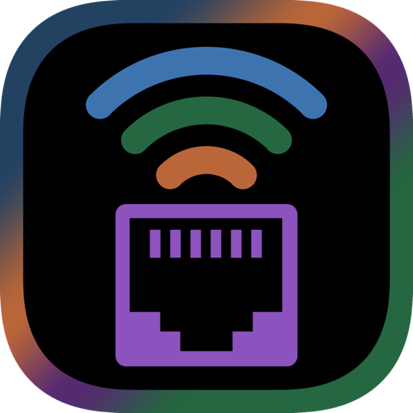
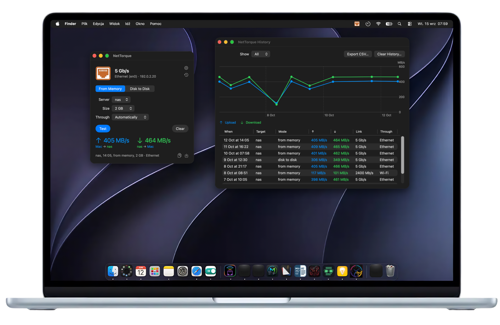

<p align="center">
  
</p>

## NetTorque

**See your wired link speed at a glance, and measure it in one click.**

A small macOS status bar app. Its icon is an Ethernet port (or a Wi‑Fi sign) in the colour of the link speed,
and its window copies data to a server over SSH and back to show how fast the link really is.

[](https://developer.apple.com/xcode/)
[](https://www.apple.com/macos)
[](LICENSE)

> The interface is in English and Polish — NetTorque follows the system language, or the one chosen in its settings.

<p align="center">
  
</p>

---

## What it shows

| Icon | Link |
|---|---|
| blue | 1 Gb/s |
| green | 2.5 Gb/s |
| orange | 5 Gb/s |
| purple | 10 Gb/s |
| grey | another speed, e.g. 100 Mb/s |
| grey with a red slash | no cable link |

**Wi‑Fi**: choose the Wi‑Fi card under **Network Card** and the icon becomes a Wi‑Fi sign in the same colours, by the
radio's transmit rate: 600 Mb/s and more blue, 2000 green, 4000 orange, 8000 purple, below that grey; grey with a red
slash when it has no network. An idle radio slows down, so the icon shows the best rate of the last minute. The menu
adds the band, channel width and signal. Wi‑Fi only notifies when the connection is lost — its rate moves all the time.

The icon pulses while a test runs. **In the Menu Bar** in the settings can put the link speed ("5G") or the last
result ("↑405 ↓464") beside it.

When the link runs slower than the card can, at half duplex, or with transmission errors, an orange
warning appears next to the speed in the window (and a line in the menu). Click it for what to check
and what the card reports: its top speed, duplex, flow control, energy saving (EEE), MTU and errors.

## Using it

- **Left click** the icon — the test window. **Right click** — the menu (link, quick test, last result, settings).
- **Double-click** NetTorque in Finder — the window; at login it starts quietly in the menu bar. It shows in the Dock
  only while one of its windows is open.
- **Test**: pick the mode, the server and the size (1 / 2 / 5 / 10 GB, default 2 GB) and press **Test**.
  **Through** picks the card the test goes over — *Automatically* (the system's way) or a particular Ethernet or
  Wi‑Fi card with an address; a network folder always goes the system's way.
  - *From Memory* — generated data to the server and back; disks take no part.
  - *Disk to Disk* — a file of random data from the Mac's disk to a folder on the server and back,
    flushed to disk on both sides. The file is always removed on both sides, also after **Stop**.
- **Result**: ↑ upload in the Mac's colour (blue), ↓ download in the server's colour (green), each with
  the names of the two devices. 1 MB = 10⁶ bytes. **Clear** empties the window; the result stays in the history.

**Share a result**: the two buttons under it copy it as a picture or save it as a PNG. The picture says "Mac" and
"Server" unless **Show the Mac and server names on the result picture** is on in the settings.

**History** (the clock under the gear, or the menu) keeps every finished test: a chart of upload and download over
time, a table (with the card each test went through), a filter by server, **Export CSV…** and **Clear History…**. It lives in
`~/Library/Application Support/com.mikagosz.NetTorque/history.json` (the last 500 tests).

SSH encryption takes its share: on a 5 GbE link expect about 400–460 MB/s rather than the line's ~590 MB/s.

## Settings

- **This Mac** — the name used in results; detected on first launch, editable, **Detect** restores it.
- **Language** — System, Polski or English; **Restart NetTorque** applies the change.
- **Network Card** — **Watched Card**: which card the icon watches, wired or Wi‑Fi.
- **Notifications and Startup** — a notification when the link is lost or slows down (a speed has to hold for
  3 s first), and **Open NetTorque at Login**. *Slower Than* sets what counts as slowing down: the best speed this
  card has had on this Mac (the default; **Reset** forgets it, e.g. after moving to another switch) or a fixed
  1 / 2.5 / 5 / 10 Gb/s.
- **Servers** — name, address (IP, host name or an `~/.ssh/config` alias), SSH user, folder for the test file.
  NetTorque logs in with your SSH key, like `ssh <address>` in Terminal — it never asks for a password.
- **Version** — at the bottom of the settings, and the last line of the menu; below it **Check for updates once a
  month** (on by default) and **Check Now**. A newer version downloads, is checked and replaces the app, which
  restarts; a running test holds it back until it ends. Crash reports stay off.

## The server

A server is either reached over SSH (below) or is a **network folder** — a share mounted in Finder (SMB, NFS, AFP).
For a folder no SSH is needed: the test writes a file there and reads it back, bypassing the Mac's file cache on both
directions so the result is the network and the server, not memory. *From Memory* and *Disk to Disk* work the same
way as for SSH. Settings → Servers → **Type**, then **Choose…** the folder under `/Volumes`.

**Another Mac**: turn on **Receive tests from other Macs** in the settings of one Mac (off by default). It shows a
6-digit code. On the other Mac it appears under **Found on the network** — **Pair…**, type the code, and test against
it from memory, with no SSH and no encryption, so the result comes closer to the full line. Every connection proves
it knows the code (an HMAC over a fresh random challenge); after five wrong codes from one address the receiver turns
that address away for ten minutes, while Macs that already showed the right code keep getting in; one test at a time, up to 10 GB, and nothing is written to disk. macOS may ask once whether to accept
incoming connections. **New Code** ends every pairing.

**Mounted in Finder** under the servers lists the network shares mounted right now — **Add** makes one a network
folder in one click. **Found on the network** lists SSH servers and SMB shares that announce themselves (Bonjour),
with their address, without this Mac. **Add** puts an SSH server in; for a share that is not mounted yet,
**Connect in Finder…** opens its login, and once mounted it moves to *Mounted in Finder*. The first time macOS asks for local network access; if a server cannot be reached, the error points to
System Settings → Privacy & Security → Local Network.

For an SSH server:

- Any machine you can reach with `ssh` and a key: a POSIX shell with `head`, `cat`, `wc`, `df`, `sync` and `find`
  (Linux, a NAS, another Mac).
- **Connect once from Terminal first** (`ssh <address>`) to accept the server's host key — NetTorque runs `ssh`
  without questions, so an unknown host key ends the test with an error.
- *Disk to Disk* needs free space for one test file in the chosen folder. Test files are named `nettorque-<id>.bin`;
  NetTorque removes them after every test, when you quit during a test, and — if a test was cut short by a crash
  or a power loss — the next time it tests disk to disk (files older than an hour).

## Uninstalling

Quit NetTorque, turn off **Open NetTorque at Login** if it was on, and move `NetTorque.app` to the Trash.
Its settings stay in `~/Library/Preferences/com.mikagosz.NetTorque.plist`, its history in
`~/Library/Application Support/com.mikagosz.NetTorque/` and its cache folder in
`~/Library/Caches/com.mikagosz.NetTorque/` — remove all three to leave nothing behind.

## Building

```bash
./build.sh
```

Runs the checks in `Tests/check.sh`, builds the Release configuration, installs to `~/Applications`
(or the folder named in an untracked `.install-dir`) and starts the app. `--no-open` installs without starting it.

## How the speed is read

`SIOCGIFXMEDIA` on the chosen interface (the extended media word, as `ifconfig` reads it), refreshed on the
system's link notifications and every 5 seconds.

## Licence

The source code is released under the [MIT licence](LICENSE).
